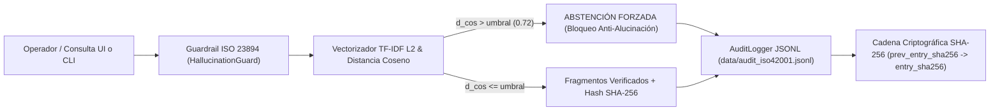

# 🛡️ Matriz de Cumplimiento Normativo: ISO/IEC 42001:2023 & ISO/IEC 23894:2023

> **Sistema:** `DGA Core Tools — TrazaBD_EXP (Profiler & Módulo de Oposiciones Gob.cl)`  
> **Autoría:** `Daniel Díaz L. & AI Engine Antigravity`  
> **Ambientes Objetivo:** Producción (`172.16.71.41` / `PRO-SQLWSPCLU`) y QA (`172.19.30.111` / `pro-dga-sql2019`)

---

## 1. Resumen de Arquitectura de Gobernanza

Este repositorio implementa controles técnicos deterministas y verificables en código para satisfacer los requisitos de:
- **ISO/IEC 42001:2023** (*Information technology — Artificial intelligence — Management system*): Trazabilidad de consultas, integridad de datos/artefactos y registro de eventos auditable.
- **ISO/IEC 23894:2023** (*Information technology — Artificial intelligence — Guidance on risk management*): Mitigación del riesgo de alucinación, medición cuantitativa de incertidumbre (distancia vectorial) y cláusulas de abstención forzada.



---

## 2. Matriz de Trazabilidad de Controles

| Norma y Cláusula | Control Exigido | Implementación Técnica en el Repositorio | Evidencia / Verificación Automatizada |
| :--- | :--- | :--- | :--- |
| **ISO/IEC 42001:2023** (`A.6.2.8` / `A.9.3`) | Registro estructurado de cada consulta y evento del sistema en formato auditable e inmutable. | `AuditLogger.log_query()` en `src/governance.py` escribe en `data/audit_iso42001.jsonl` con cadena de custodia `prev_entry_sha256` $\rightarrow$ `entry_sha256` y sanitización de credenciales (`sanitize_audit_payload`). | `tests/test_governance.py::test_jsonl_audit_log_structure_and_tamper_evident_chain` y comando `python qa_cli.py audit-verify` |
| **ISO/IEC 42001:2023** (`A.7.4` / `A.8.4`) | Cálculo y almacenamiento del hash criptográfico SHA-256 de cada archivo o fragmento recuperado. | `compute_file_sha256()`, `compute_canonical_sha256()` y `stamp_fragments_collection()` estampan `sha256` en cada expediente, oposición, evento XEL y fragmento RAG. | `tests/test_governance.py::test_sha256_file_and_fragment_hashing` y comando `python qa_cli.py manifest` |
| **ISO/IEC 23894:2023** (`6.3` / `6.4.3`) | Mitigación de alucinaciones forzando cláusulas de abstención y registrando la distancia vectorial de similitud. | `HallucinationGuard.retrieve_and_evaluate()` calcula `cosine_distance`, `cosine_similarity` y `euclidean_distance` ($L_2$). Si $d_{\cos} > d_{\max}$, fuerza `abstained = True` y emite `ABSTENTION_CLAUSE_TEMPLATE`. | `tests/test_governance.py::test_hallucination_guard_vector_distance_and_forced_abstention` y comando `python qa_cli.py rag-query` |
| **ISO/IEC 23894:2023** (`6.4.2`) | Prevención de impacto destructivo en bases productivas (`BD_EXP`, `BD_PAR`, `BD_MAP`). | `validate_sql_safety()` en `src/governance.py` bloquea `DROP`, `TRUNCATE`, `DELETE`, `ALTER`, `INSERT` y `UPDATE` directos sobre las bases de negocio. | `tests/test_governance.py::test_sql_safety_and_payload_sanitization` |

---

## 3. Comandos de Verificación para Auditores en Producción

```powershell
# 1. Ejecutar la suite completa de pruebas unitarias y de gobernanza ISO
$env:PYTHONPATH="."; .\.venv\Scripts\python.exe -m pytest -v

# 2. Verificar la integridad criptográfica de la cadena de auditoría JSONL
.\.venv\Scripts\python.exe qa_cli.py audit-verify

# 3. Emitir el manifiesto SHA-256 de todos los archivos críticos del sistema
.\.venv\Scripts\python.exe qa_cli.py manifest

# 4. Probar evaluación de distancia vectorial y abstención desde terminal
.\.venv\Scripts\python.exe qa_cli.py rag-query "CPA_BusquedaExpedientesOp en BD_EXP"
```
